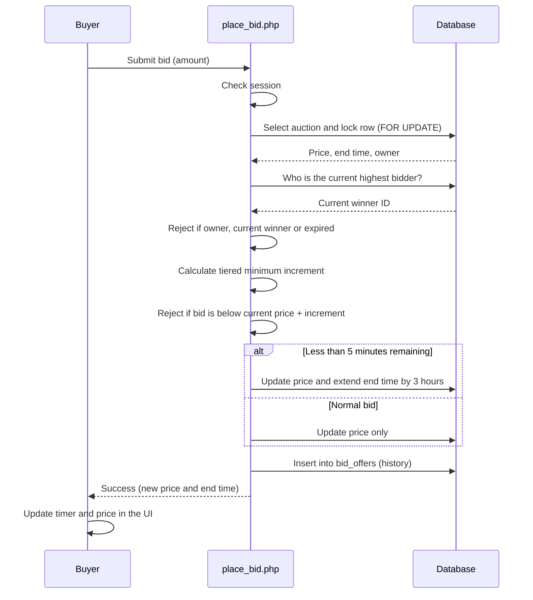
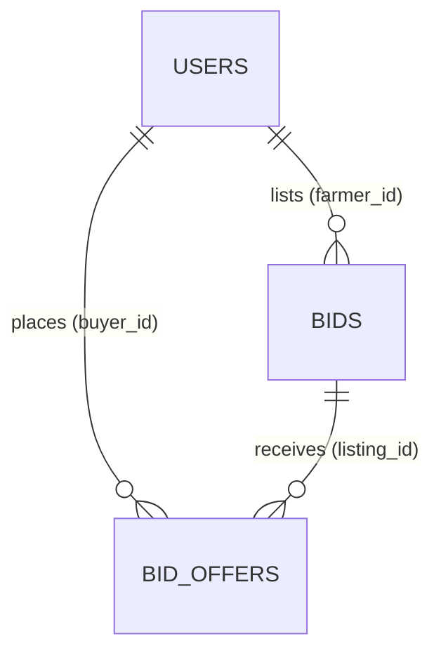

# Farmer Bidding System

An online auction platform where farmers list agricultural equipment and buyers bid on it directly, with no middlemen. Built with PHP, MySQL, Bootstrap 5 and vanilla JavaScript.


## Why this project

Farmers often lose a large share of a sale's value to intermediaries, and traditional auctions are slow, costly and limited to people who can physically attend. This platform lets sellers list machinery and produce from anywhere and lets buyers compete in a transparent, time-limited auction where every bid is recorded.

## Features

### For farmers (sellers)
- Create, edit and delete auction listings with details such as category, year, operating hours, condition, location, starting bid and duration (1 to 30 days)
- Public or private listing visibility
- Image upload with instant preview (JPG, PNG, WEBP, up to 5 MB)
- Dashboard with active and closed status badges and quick actions
- Review all offers on a listing and accept or reject bids

### For buyers (bidders)
- Homepage with a hero carousel, category sections with horizontally scrollable cards, and an Urgent Auctions section
- Live search across item names, categories and locations
- Live countdown timers on every auction card
- Asynchronous bidding (Fetch API) with client-side and server-side validation, so the page never reloads
- Bid history for every auction

### For administrators
- View, activate, block or delete user accounts, with a detailed profile modal for each user
- View, close, reopen or delete any auction
- Monitor the highest bid and acceptance status of each listing

## Bidding engine

The core of the project is the bid placement flow in `place_bid.php`. It runs inside a single database transaction so concurrent bidders can never leave the data in an inconsistent state.

- **Row locking:** the auction row is locked with `SELECT ... FOR UPDATE` before any checks run
- **Validation:** the auction must be open and not expired, sellers cannot bid on their own items, and the current highest bidder cannot outbid themselves
- **Tiered bid increments:** the minimum increase scales with the current price, so a Rs 500,000 tractor is not stuck with Rs 100 steps
- **Anti-sniping soft close:** a bid placed in the last 5 minutes extends the auction by 3 hours
- **Atomic updates:** the bid is inserted into `bid_offers` and the auction's price, increment, bid count and end time are updated together, or everything rolls back



### Increment tiers

| Current bid (Rs)     | Minimum increment (Rs) |
|----------------------|------------------------|
| Under 1,000          | 100                    |
| 1,000 to 9,999       | 500                    |
| 10,000 to 99,999     | 5,000                  |
| 100,000 to 999,999   | 50,000                 |
| 1,000,000 to 9,999,999 | 500,000              |
| 10,000,000 and above | 5,000,000              |

## Tech stack

| Layer     | Technology |
|-----------|------------|
| Frontend  | HTML5, CSS3 (Flexbox and Grid), JavaScript ES6+, Bootstrap 5.3, Font Awesome 6.4 |
| Backend   | PHP 8.x, MySQLi / PDO, session-based authentication, JSON endpoints for AJAX |
| Database  | MySQL 8.0 |
| Tools     | Git, Composer, phpMyAdmin |

## Database overview

| Table        | Purpose |
|--------------|---------|
| `users`      | Accounts with role (`admin`, `farmer`, `buyer`), status (`active`, `blocked`) and contact details. Passwords are stored as bcrypt hashes. |
| `bids`       | Auction listings: owner, title, category, description, location, starting bid, current price, minimum increment, item specs, image path, visibility, status, bid count and end time. |
| `bid_offers` | Every individual bid with its buyer, amount, status (`active`, `accepted`, `rejected`) and timestamp. This is the full audit trail. |
| `transactions` | Completed sales. |



Money values use `DECIMAL` to avoid floating-point rounding errors, and foreign keys enforce referential integrity between users, listings and bids.

## Security

- Prepared statements with parameter binding for database queries, to prevent SQL injection
- Passwords hashed with `password_hash` (bcrypt) and checked with `password_verify`
- Output encoding with `htmlspecialchars` to prevent XSS
- Session ID regeneration after login, session timeouts, and HTTPOnly and Secure cookie flags
- Blocked accounts are rejected at login
- Role checks on protected pages (admin, farmer, buyer)
- Image uploads checked against a type allow-list and a 5 MB size limit, and saved under generated unique filenames

## Getting started

### Prerequisites

- PHP 8.x
- MySQL 8.0
- A local server stack such as XAMPP, WAMP or Laragon (or Apache/Nginx with PHP)
- Composer (optional, for dependencies)

### Installation

1. **Clone the repository**
   ```bash
   git clone https://github.com/mkat11590-svg/<your-repo-name>.git
   cd <your-repo-name>
   ```

2. **Create the database**

   Open phpMyAdmin (or the MySQL CLI), create a database and import the SQL file:
   ```bash
   mysql -u root -p -e "CREATE DATABASE farmer_bidding;"
   mysql -u root -p farmer_bidding < database/schema.sql
   ```

3. **Configure the connection**

   Edit the database constants in the config file:
   ```php
   define('DB_HOST', 'localhost');
   define('DB_USER', 'root');
   define('DB_PASS', '');
   define('DB_NAME', 'farmer_bidding');
   ```

4. **Make the upload folder writable**

   Make sure the folder used for auction images exists and the web server can write to it.

5. **Run the app**

   Place the project in your server's web root (for example `htdocs` in XAMPP) and open `http://localhost/<your-repo-name>/`.

## Project structure

The backend is split into focused modules. Adjust the folder names below to match the repository.

```
.
├── config/        # Database connection and global constants
├── auth/          # Registration, login, logout, authorization checks
├── bids/          # Auction CRUD and bid placement
├── api/           # JSON endpoints used by the frontend
├── admin/         # User and auction management tools
├── farmer/        # Seller tools for evaluating received bids
├── includes/      # Shared header, footer and CSS includes
├── assets/        # CSS, JavaScript, images
└── database/      # SQL schema
```

## Screenshots

<!--
Add screenshots to docs/screenshots/ and uncomment these lines.

| Homepage | Auction details |
|----------|-----------------|
|  |  |

| Farmer dashboard | Admin panel |
|------------------|-------------|
|  |  |
-->

## Roadmap

**Next up**
- Account verification and admin approval before a user can bid or list (CNIC, phone OTP)
- Admin approval workflow for new listings
- Winner selection and sale completion flow
- Inline error messages instead of browser alerts
- CSRF tokens on forms and rate limiting on bid submissions

**Planned**
- Smart starting-price suggestions based on past auctions
- USD and PKR price display
- "My Bids" page, watchlist and email / in-app notifications
- Seller and buyer rating system

**Long term**
- English and Urdu language support
- Comment and chat threads on listings
- Payment integration and escrow
- Mobile apps for iOS and Android
- Crop and produce bidding

## Team

| Name | Role |
|------|------|
| Muhammad Abdullah Tariq | CEO & Founder |
| Zubair Maqsood | Chief Technology Officer |
| Daud Ibrahim | Head of Operations |
| M. Hannan Shoaib | Customer Success Lead |

## License

Add a license for the project here (for example MIT) and include the matching `LICENSE` file in the repository.
